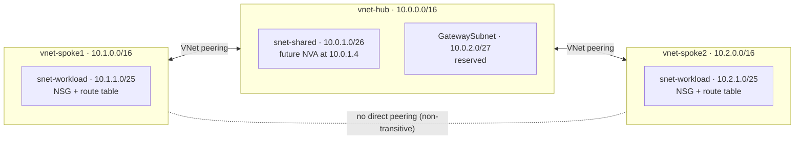
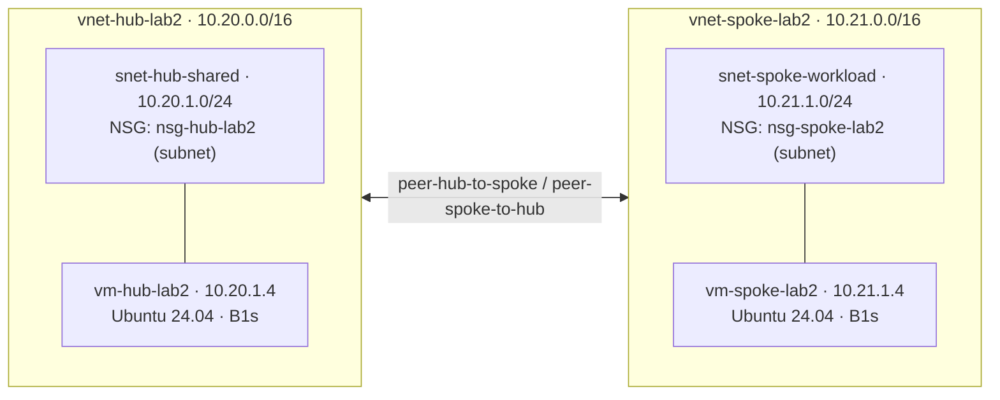
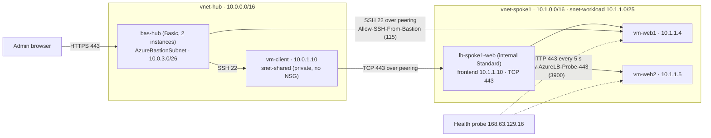

# Azure Hub-and-Spoke Network (Bicep)

A hub-and-spoke virtual network topology on Microsoft Azure, deployed as Infrastructure as Code with Bicep. The repository has three labs:

- **Lab 1: Bicep-first network.** A reusable spoke module deploys multiple isolated spokes from a single array, with least-privilege NSGs and forced routing through the hub.
- **Lab 2: Portal-built connectivity validation.** A small hub-and-spoke environment was built by hand in the Azure portal, then exported, decompiled, and cleaned up into Bicep. Its configuration findings were fixed through code, and connectivity was verified with real traffic tests. See [Lab 2](#lab-2-portal-built-connectivity-validation).
- **Lab 3: Internal load balancer and Azure Bastion.** Two web VMs in spoke1 behind an internal Standard Load Balancer, a measured failover test, and Bastion access to VMs in the hub and in a peered spoke. Two NSG fixes found during the lab went back into the Lab 1 code. See [Lab 3](#lab-3-internal-load-balancer-and-azure-bastion).

Built as a hands-on project while studying for the **AZ-104: Microsoft Azure Administrator** certification. Everything here is lab work in a personal subscription, not a production environment.

> **Status (2026-11-05):** Lab 1's network is still deployed in `rg-hubspoke-lab` at $0, now including the two NSG rules from Lab 3 and a storage service endpoint on the spokes (from Project 2 Lab 4; see [Routing Design](#routing-design)). **Lab 3 was torn down** the same day it ran ([evidence](docs/evidence/lab3-06-teardown.txt)). **Lab 2 was torn down** on 2026-11-01 ([evidence](docs/evidence/teardown-lab2-2026-11-01.txt)); all of its evidence is kept in this repo, and it can be rebuilt from `lab2/main.bicep` (see [Rebuilding Lab 2](#rebuilding-lab-2)). Before teardown, the Lab 2 VMs were also used as the monitored workload in Project 2 (Azure Monitoring and Incident Response) and as the protected workload in Project 5 (Azure Backup and Recovery Lab). Interview prep: [`docs/interview-guide.md`](docs/interview-guide.md).

## Problem It Solves

As organizations grow in Azure, putting every workload in one flat network becomes hard to secure and manage. The hub-and-spoke model solves this by:

- Centralizing shared services (VPN gateway, firewall, DNS) in a single **hub** so they're deployed and paid for once
- Isolating workloads in separate **spokes** that connect only to the hub
- Enforcing security and traffic inspection in one place

Lab 1 builds that foundation with least-privilege network security, forced routing through the hub, and a modular design where adding a new spoke takes one line of code.

Lab 2 addresses a different, very common operational problem: **environments built by hand in the portal drift from standards and can't be reproduced.** It shows how to bring an existing environment under code, find what's wrong with it, and fix it safely.

## Architecture (Lab 1)



### Address Plan

| VNet | Address space | Subnet | Prefix | Usable IPs |
|---|---|---|---|---|
| vnet-hub | 10.0.0.0/16 | snet-shared | 10.0.1.0/26 | 59 |
| vnet-hub | 10.0.0.0/16 | GatewaySubnet | 10.0.2.0/27 | 27 |
| vnet-spoke1 | 10.1.0.0/16 | snet-workload | 10.1.1.0/25 | 123 |
| vnet-spoke2 | 10.2.0.0/16 | snet-workload | 10.2.1.0/25 | 123 |
| vnet-hub-lab2 *(Lab 2)* | 10.20.0.0/16 | snet-hub-shared | 10.20.1.0/24 | 251 |
| vnet-spoke-lab2 *(Lab 2)* | 10.21.0.0/16 | snet-spoke-workload | 10.21.1.0/24 | 251 |

Usable IPs account for the 5 addresses Azure reserves in every subnet. No address spaces overlap, which VNet peering requires. Lab 2 uses 10.20.0.0/16 and up so it never collides with Lab 1's spokes.

## Repository Structure

```
├── main.bicep                    # Lab 1: hub VNet, spoke definitions, hub → spoke peerings
├── modules/
│   ├── spoke.bicep               # Lab 1: reusable spoke (VNet, NSG, route table, spoke → hub peering)
│   └── vm.bicep                  # Lab 1 VM layer: reusable Linux VM + NIC
├── vms.bicep                     # Lab 1 VM layer: three B1s VMs (authored and what-if reviewed; not yet deployed)
├── lab3/
│   └── lb.bicep                  # Lab 3: the portal-built internal load balancer + backend NICs, as code (what-if only)
├── lab2/
│   ├── main.bicep                # Lab 2: portal-built environment codified as Bicep (findings fixed)
│   ├── Test-Lab2Connectivity.ps1 # Lab 2: connectivity test matrix (PASS/FAIL); deallocates in finally
│   └── export/                   # Raw portal export + decompiled output (gitignored; reference only)
└── docs/
    ├── evidence/                 # Sanitized command output for every milestone (m1-*, m2-*, lab2-*, lab3-*, teardown)
    └── interview-guide.md        # Walkthrough, deep-dive outline, likely questions, practice challenges
```

Compiled ARM JSON (`*.json`) and raw portal exports are gitignored. Subscription and tenant IDs in evidence files are replaced with `<guid>`.

## Resources Deployed (Lab 1)

| Resource | Names | Purpose |
|---|---|---|
| Virtual networks | `vnet-hub`, `vnet-spoke1`, `vnet-spoke2` | Hub for shared services; isolated workload spokes |
| VNet peerings (x4) | `peer-hub-to-spokeN`, `peer-spokeN-to-hub` | Bidirectional hub ↔ spoke connectivity |
| Network security groups | `nsg-spoke1-workload`, `nsg-spoke2-workload` | Least-privilege inbound rules per workload subnet |
| Route tables | `rt-spoke1-workload`, `rt-spoke2-workload` | Force spoke egress through the hub |

Every taggable resource carries the standard tags `project`, `environment`, `owner`, and `costCenter`.

## How the Modular Design Works

All spokes are defined in one array in `main.bicep`:

```bicep
var spokes = [
  { name: 'spoke1', addressSpace: '10.1.0.0/16', workloadSubnetPrefix: '10.1.1.0/25' }
  { name: 'spoke2', addressSpace: '10.2.0.0/16', workloadSubnetPrefix: '10.2.1.0/25' }
]
```

A `for` loop calls `modules/spoke.bicep` once per spoke. The module returns each spoke's VNet ID as an **output**, which `main.bicep` uses to create the hub-side peering. Both loops use `@batchSize(1)` because Azure can't modify multiple peerings on the same hub VNet at the same time.

**To add a third spoke:** add one object to the `spokes` array and redeploy.

## Security Design

Each workload subnet NSG allows only what's needed and explicitly overrides Azure's default `AllowVnetInBound` rule. That default rule would otherwise allow **all** traffic from peered VNets.

| Priority | Rule | Source | Port | Action |
|---|---|---|---|---|
| 100 | Allow-HTTPS-From-Hub | Hub address space | 443 | Allow |
| 110 | Allow-Mgmt-From-Shared | Hub shared subnet | 22, 3389 | Allow |
| 115 | Allow-SSH-From-Bastion | `10.0.3.0/26` (Bastion range) | 22 | Allow |
| 120 | Allow-Intra-Subnet | Workload subnet | Any | Allow |
| 3900 | Allow-AzureLB-Probe-443 | `AzureLoadBalancer` tag | 443 | Allow |
| 4000 | Deny-VNet-Inbound | VirtualNetwork | Any | Deny |

Rules 115 and 3900 were added in Lab 3 (see [why](#incident-1-health-probes-at-0)). `Allow-Intra-Subnet` was added in Milestone 1. Without it, the priority-4000 deny would also block traffic between VMs in the same workload subnet, because `VirtualNetwork` includes the subnet itself.

## Routing Design

Each spoke has a user-defined route sending all egress (`0.0.0.0/0`) to `10.0.1.4` in the hub, where a firewall or network virtual appliance (NVA) would inspect traffic. Peering is **not transitive**, so this pattern is also how spoke1 and spoke2 would reach each other: through the hub NVA rather than a direct peering.

> **Note:** No NVA is deployed yet, to keep costs at $0. The routes show the design intent. `vms.bicep` defines a `vm-nva` at 10.0.1.4 (IP forwarding off by default) for a future routing scenario.

**Side effect, found in Project 2 Lab 4 (2026-11-05):** with no appliance at 10.0.1.4, the `0.0.0.0/0` route **blackholes** everything leaving the spoke for a public IP, including Azure Storage. Next hop reports `None`. A Network Watcher packet capture on a spoke VM failed with `InternalServerError` because the VM's agent couldn't upload to storage; the same capture on the hub VM, which has no route table, worked.

**Fix in code:** `modules/spoke.bicep` now adds a **`Microsoft.Storage` service endpoint** to each spoke's workload subnet. That adds routes for the region's storage address ranges with next hop `VirtualNetworkServiceEndpoint`. They're more specific than `0.0.0.0/0`, so they win. After the deploy, storage from the spoke went from a timeout to HTTP 400 (reachable), and the capture uploaded. The fix is free.
- **Trade-off:** storage traffic bypasses the future hub firewall. A private endpoint would be the stricter choice.
- **Live difference:** Azure added `westus` and `westus3` to the endpoint's locations by itself. What-if marks this as no effect.

Evidence and the full investigation are in the [monitoring repo's Lab 4 section](https://github.com/ChefBoyRJeff/azure-monitoring-incident-response#lab-4-network-watcher).

## Cost Controls

Guardrails were put in place **before** deploying anything:

- **Budget:** $10/month with alerts at 50% and 80% actual spend and 100% forecasted spend
- **Azure Policy:** The built-in *Not allowed resource types* policy, assigned at subscription scope with a Deny effect, blocks expensive resources such as VPN gateways, Azure Firewall, Bastion, NAT gateways, Application Gateway, ExpressRoute, and DDoS Protection plans. It was tested by attempting to create a NAT gateway, which was correctly rejected with `RequestDisallowedByPolicy`.

**Lab 1 running cost: $0.** VNets, subnets, NSGs, route tables, and peering with no traffic are free.

**Lab 2 running cost: $0 since 2026-11-01** (torn down). While it existed, the VMs were kept **deallocated**, so the only charge was the two StandardSSD OS disks, at **about $5/month combined (estimate)**. See [Lab 2 cost and preservation](#cost-and-preservation-policy).

## Deploy It Yourself (Lab 1)

**Prerequisites:** Azure subscription, [Azure CLI](https://learn.microsoft.com/cli/azure/install-azure-cli), and Bicep (`az bicep install`).

```bash
az login
az group create --name rg-hubspoke-lab --location eastus
az deployment group what-if --resource-group rg-hubspoke-lab --template-file main.bicep
az deployment group create --resource-group rg-hubspoke-lab --template-file main.bicep
```

### Verify

```bash
# Hub should show two Connected peerings; each spoke shows one (to the hub only)
az network vnet peering list -g rg-hubspoke-lab --vnet-name vnet-hub -o table
az network vnet peering list -g rg-hubspoke-lab --vnet-name vnet-spoke1 -o table
az network vnet peering list -g rg-hubspoke-lab --vnet-name vnet-spoke2 -o table

# Module deployments appear as nested deployments
az deployment group list -g rg-hubspoke-lab -o table
```

Milestone 1 evidence: `docs/evidence/m1-whatif.txt` and `m1-verify.txt` (4 peerings Connected / FullyInSync, NSG rule order 100/110/120/4000). The VM layer's what-if is in `m2-whatif.txt`.

### Clean Up

```bash
az group delete --name rg-hubspoke-lab --yes --no-wait
```

---

## Lab 2: Portal-Built Connectivity Validation

### Why This Lab Exists

Most real Azure environments weren't built from code. Someone clicked through the portal, it worked, and now nobody can say exactly how it's configured or rebuild it. This lab practices the "brownfield to Infrastructure as Code" workflow:

1. Build a small hub-and-spoke environment **by hand in the portal** and confirm it works.
2. **Export** it, **decompile** it to Bicep, and clean the result up until it describes the real environment exactly (verified with what-if).
3. **Find** what's wrong with the portal build, and **fix** each issue through code, one change at a time.
4. **Prove** the fixes with real traffic tests, not just configuration checks.

### Architecture



| Design choice | Reason |
|---|---|
| **No public IPs, no Bastion** | Lower cost and attack surface. Bastion is also blocked by this subscription's cost policy. Tests run through **Azure Run Command**, which works through the VM agent rather than the internet |
| **`defaultOutboundAccess: false`** on both subnets | Private subnets: VMs have no implicit outbound internet access |
| **Standard_B1s, SSH key only** | Lowest-cost size available on this subscription (Basv2 quota is 0). Password authentication is disabled. Private keys stay on the local machine and are never in this repository |
| **VMs stay deallocated between sessions** | Removes compute cost while keeping the lab for reuse |

All Lab 2 resources lived in `rg-hubspoke-vms` and carried the tag `lab=lab2`. The resource group was deleted on 2026-11-01.

### Step A: From Portal to Code

| Step | Result | Evidence |
|---|---|---|
| Inventory the portal build | 12 resources: 2 VNets, 2 NSGs, 2 NICs, 2 VMs, 2 OS disks, 2 SSH public key resources. No public IPs | `lab2-inventory.txt` |
| Export the resource group and run `az bicep decompile` | **18 errors** (10× BCP062, 6× BCP080, 2× BCP079) and 2 linter warnings | `lab2-01-decompile.txt` |
| Clean up by hand into `lab2/main.bicep` | Builds cleanly | `lab2/main.bicep` |
| What-if against the live environment | **0 creates, 0 deletes.** VMs and NSGs unchanged. All "modify" lines are service defaults or read-only fields (noise) | `lab2-02-whatif-asis.txt` |

**Why decompile failed:** the exported template declared subnets and peerings **twice**: inline inside each VNet and again as separate child resources. The two copies referenced each other (BCP080 cycles, BCP079 self-references), and resources pointing at the broken declarations then failed too (BCP062). The fix was to keep subnets inline, keep peerings as separate child resources, and build the NIC subnet IDs from the VNet ID.

`lab2-inventory.txt` also preserves a real tooling failure from that first attempt. JMESPath filters such as `[?contains(name,'lab2')]` broke when passed through `az.cmd` on Windows (`] was unexpected at this time`). The working approach, used in every later command, is to return JSON and filter in PowerShell with `ConvertFrom-Json | Where-Object`.

### Findings and Root-Cause Analysis

| # | Finding | Impact | Root cause | Fix | Verified by |
|---|---|---|---|---|---|
| 1 | The **same NSG was attached to both the subnet and the NIC** | No added security. Every rule is evaluated twice, and effective-rule and IP flow verify output shows two layers for one policy, which confuses troubleshooting | Likely cause (not confirmed): in the VM wizard's Networking tab, the NIC network security group option was pointed at the same NSG that was already attached to the subnet | B.1: removed the NIC association in Bicep; the subnet NSG remains | `lab2-03` to `lab2-06`; effective NSGs in `lab2-16` |
| 2 | **Peering names were swapped.** The hub VNet held `peer-spoke-to-hub` | Names that describe the wrong direction send troubleshooters to the wrong side | Likely cause: manual naming during portal creation. The Add peering dialog asks for both link names (this VNet's and the remote VNet's) on one screen, which makes them easy to swap | B.3: deleted both peerings with the CLI, then recreated them from Bicep with correct names | `lab2-10` to `lab2-15`; routes in `lab2-16` |
| 3 | **No tags** on any resource | Lab 2 cost couldn't be separated from other resources in Cost Management | Tags were never entered in the portal | B.2: standard tag set plus `lab=lab2` via Bicep; disks and SSH keys tagged with a CLI merge | `lab2-07` to `lab2-09` (12 of 12 tagged) |
| 4 | **NSGs contained only the default rules** | `AllowVnetInBound` allowed **all** traffic from the peered VNet. An initial manual TCP 8080 test from the portal build succeeded for this reason (that test wasn't captured as evidence) | Portal-created NSGs start with defaults only | B.5: least-privilege inbound rules on both NSGs, ending in an explicit `Deny-VNet-Inbound` at priority 4000 | Before: IP flow verify in `lab2-16` names `AllowVnetInBound`. After: `lab2-19` (rules) and `lab2-21` (8 of 8 PASS, including TCP 8080 blocked) |

**Prevention:** build from code first. Where portal builds happen, export and what-if them against a standard. Enforce tags with Azure Policy (for example *Require a tag on resources*), because tags don't inherit from a VM to its disks.

### Step B: Fixing Through Code

Each fix followed the same loop: **capture "before" evidence → edit Bicep → what-if → compare it with the previous what-if → deploy → verify.** Comparing what-ifs line by line is what separates real changes from noise. In B.1, the only new lines were the two `- networkSecurityGroup` removals.

| Milestone | Change | Deploy time | Result |
|---|---|---|---|
| B.1 | Remove the NIC-level NSG association | 24 s | Both NICs `[]`; subnet NSGs still attached; peerings unaffected |
| B.2 | Add tags (8 resources in Bicep, 4 by CLI merge) | 4 s | 12 of 12 tagged, 0 missing |
| B.3 | Fix the peering names | 3 s | Correct names, Connected / FullyInSync; drift check shows 0 creates and 0 deletes |
| B.4 | Connectivity retest with real traffic | 5.2 min VM runtime | All tests passed (below) |
| B.5 | Least-privilege NSG rules (finding 4); test script v2 with negative tests | 4 s; 5.7 min VM runtime | 8 of 8 PASS (below) |

The VMs stayed **deallocated** through every configuration change. Deploying unchanged VM definitions doesn't start a deallocated VM.

### Controlled Failure: What-If Isn't Validation

A resource can't be renamed in Azure, so "rename a peering" means delete and recreate. Bicep in Incremental mode **never deletes** resources, so changing the names in code tries to **add** two new peerings next to the old ones.

| Test | Result | Evidence |
|---|---|---|
| What-if with new names, old peerings still present | **2 creates, 0 deletes, no warning.** It also showed a misleading `~ name: "peer-spoke-to-hub" => "peer-hub-to-spoke"` line that looks like a rename but isn't a deployment action | `lab2-11` |
| Deploy anyway (deliberately) | **Failed:** `AnotherPeeringAlreadyReferencesRemoteVnet` for both sides. A VNet can't have two peerings to the same remote VNet | `lab2-11a` |
| State after the failure | Old peerings still **Connected**; no partial or failed peering left behind | `lab2-11b` |
| Delete the hub-side peering first | The spoke side immediately showed **`Disconnected`**: one half of a pair, no traffic | `lab2-12` |
| Delete the spoke side, what-if, deploy | Both peerings recreated with correct names; drift check clean | `lab2-13` to `lab2-15` |

**Lesson:** what-if predicts property changes. It doesn't check service rules such as "one peering per remote VNet." A clean what-if is necessary but not sufficient. And when a change needs a delete, the delete should be an explicit, reviewed step rather than something the deployment does by surprise.

### Connectivity Verification (B.4)

The first version of `lab2/Test-Lab2Connectivity.ps1` started both VMs, ran positive tests, and deallocated both VMs in a `finally` block. (See the [incident](#incident-interrupted-test-run-left-a-vm-running) for why `finally` reduces but doesn't remove the risk of leaving compute running.) These results are from **before** B.5, with default NSG rules:

| Test | Result |
|---|---|
| Effective NSGs | One NSG per NIC, associated through the **subnet** (confirms fix 1) |
| Effective routes | Hub: `10.21.0.0/16 → VNetPeering`. Spoke: `10.20.0.0/16 → VNetPeering`. Both Active (confirms fix 2) |
| Hub → spoke | 4/4 ping replies (about 2 ms), TCP 22 succeeded |
| Spoke → hub | 4/4 ping replies, TCP 22 succeeded |
| IP flow verify (hub → spoke TCP 22) | `Allow` by `defaultSecurityRules/AllowVnetInBound` |
| Cleanup | Both VMs deallocated; 5.2 minutes from start to deallocation |

Evidence: `lab2-16-connectivity-retest.txt`

**Two things the route table shows:**

- **Longest prefix match.** The platform also installs `10.0.0.0/8 → None` (drop). Traffic to 10.21.1.4 matches both that route and `10.21.0.0/16 → VNetPeering`. The more specific /16 wins. Without the peering, the /8 drop route would apply and packets would be silently discarded.
- **A route isn't a path.** `0.0.0.0/0 → Internet` is listed, but with `defaultOutboundAccess: false` and no public IP or NAT gateway, the VMs still have no outbound internet access.

### Least-Privilege NSGs and the Test Matrix (B.5)

Both NSGs now override `AllowVnetInBound` (priority 65000) with an explicit deny at priority 4000, and allow only what the design needs. Spokes don't manage the hub.

| NSG | Priority | Rule | Allows |
|---|---|---|---|
| Spoke | 100 | Allow-SSH-From-Hub-Shared | TCP 22 from 10.20.1.0/24 |
| Spoke | 110 | Allow-ICMP-From-Hub | ICMP from 10.20.0.0/16 |
| Spoke | 120 | Allow-Intra-Subnet | Anything within 10.21.1.0/24 |
| Spoke | 4000 | Deny-VNet-Inbound | **Denies** all other VirtualNetwork traffic |
| Hub | 100 | Allow-ICMP-From-Spoke | ICMP from 10.21.0.0/16 |
| Hub | 120 | Allow-Intra-Subnet | Anything within 10.20.1.0/24 |
| Hub | 4000 | Deny-VNet-Inbound | **Denies** all other VirtualNetwork traffic |

NSGs are **stateful**, so return traffic for the hub's SSH sessions to the spoke is allowed without an inbound rule on the hub. The address prefixes are defined once as variables and shared by the VNets and the NSG rules. What-if confirmed that this refactor changed no VNet addresses (`lab2-17`).

**Test script v2** encodes the expected result of every test and reports PASS or FAIL. A security change needs **negative tests**: proof that traffic that should be blocked actually is.

| # | Test | Expected | Actual |
|---|---|---|---|
| 1 | Hub → spoke ping | open | open |
| 2 | Hub → spoke TCP 22 | open | open |
| 3 | Hub → spoke **TCP 8080** | blocked | **timed out** (closes the original 8080 finding) |
| 4 | Spoke → hub ping | open | open |
| 5 | Spoke → hub **TCP 22** | blocked | **timed out** |
| 6 | IP flow verify: TCP 22 into spoke | Allow / Allow-SSH-From-Hub-Shared | match |
| 7 | IP flow verify: TCP 8080 into spoke | Deny / Deny-VNet-Inbound | match |
| 8 | IP flow verify: TCP 22 into hub | Deny / Deny-VNet-Inbound | match |

**Result: 8 of 8 PASS** (`lab2-21`).

A blocked TCP test passes **only on a timeout**. An NSG deny silently drops packets, so the client times out. "Connection refused" means the packet **reached** the VM and nothing was listening, so the NSG allowed it. Counting both as "blocked" would hide a misconfigured NSG behind a closed port.

`lab2-20` is the same traffic run with the **v1** script after B.5. Its heading says "expect success" for spoke → hub TCP 22, but the correct result under B.5 is the timeout it recorded. That gap is why v2 puts expectations in the test instead of in the reader's head.

**A second security layer the raw JSON revealed.** Each NIC's effective rules include a second entry associated with **`networkManager`**, not a subnet or NIC. It points to an `adminNetworkSecurityGroups` resource holding one rule, `DefaultIPv6OutboundDeny` (priority 0, Deny, to specific Azure IPv6 addresses). This is an **Azure Virtual Network Manager security admin rule**. Admin rules are evaluated **before** NSGs, and an NSG can't override them. It wasn't created in this lab and has a system-style name, so it appears to be platform-applied (not confirmed). It only affects outbound IPv6, so it has no effect on these tests. Raw data: `lab2-21-connectivity-matrix-b5-effective-nsg-raw.txt`.

### Incident: Interrupted Test Run Left a VM Running

| | |
|---|---|
| **Symptom** | After a test run was stopped with Ctrl+C, a power-state check showed `vm-hub-lab2: VM running` and `vm-spoke-lab2: VM deallocated` |
| **Evidence** | The run's log ended at `Starting vm-hub-lab2...` then `Deallocating vm-hub-lab2...`, with no further lines. That partial log was deleted as a duplicate run, so this record is written from the session, not an evidence file |
| **Root cause** | Ctrl+C arrived while `az vm start` was running. PowerShell moved to the `finally` block, but the start request had already reached Azure, so the VM kept starting. The cleanup's own `az vm deallocate` was then interrupted before it finished |
| **Remediation** | Ran `az vm deallocate` by hand and confirmed both VMs showed `VM deallocated`. About 2 minutes of one B1s VM, a fraction of a cent |
| **Prevention** | Check the power state after any interrupted run. Treat the budget alert as a slow backstop, not a stop. Planned: VM auto-shutdown as an independent guard |

**Lesson:** `finally` makes cleanup the default, but cleanup can be interrupted too. A safety mechanism should be verified, and it shouldn't be the only one.

### Rebuilding Lab 2

Lab 2 was deleted on 2026-11-01, including its SSH public key resources, so the original keys can't be read back from Azure. A rebuild uses a **new key pair**. `lab2/main.bicep` creates every resource from scratch (the OS disks use `createOption: 'FromImage'`), so it's expected to work as a fresh deployment. **This hasn't been tested yet**; run what-if first and expect about 12 creates.

```powershell
# New SSH key pair (the private key stays in your profile; never commit it)
ssh-keygen -t rsa -b 4096 -f $HOME\.ssh\lab2 -N '""'
$key = Get-Content $HOME\.ssh\lab2.pub -Raw

az group create -n rg-hubspoke-vms -l eastus
az deployment group what-if -g rg-hubspoke-vms --template-file lab2\main.bicep `
  --parameters hubSshPublicKey="$key" spokeSshPublicKey="$key"
az deployment group create  -g rg-hubspoke-vms --template-file lab2\main.bicep `
  --parameters hubSshPublicKey="$key" spokeSshPublicKey="$key"

# Deallocate immediately: the VMs start on creation
az vm deallocate --ids $(az vm list -g rg-hubspoke-vms --query "[].id" -o tsv)

# Test matrix (billable for a few minutes; deallocates at the end). Use a new file name each run.
.\lab2\Test-Lab2Connectivity.ps1 -OutFile docs\evidence\lab2-NN-connectivity-matrix.txt

# After ANY run, and always after an interrupted one: confirm both VMs show "VM deallocated"
az vm list -d -g rg-hubspoke-vms --query "[].{name:name,power:powerState}" -o table
```

**Note:** Project 2's alert rules targeted these VMs and were deleted after the teardown. Redeploy Project 2's Bicep after rebuilding if you want the alerts back.

### Evidence Index

| File | Contents |
|---|---|
| `lab2-inventory.txt` | Initial inventory of the portal build, including the first failed JMESPath attempt |
| `lab2-01-decompile.txt` | Decompile output: 18 errors, 2 warnings |
| `lab2-02-whatif-asis.txt` | Baseline what-if: the code matches the live state |
| `lab2-03` to `lab2-06` | B.1: NIC NSG before, what-if, deploy, verify |
| `lab2-07` to `lab2-09` | B.2: tags what-if, deploy, verify (12 of 12) |
| `lab2-10`, `lab2-11` | B.3: peerings before; what-if with old peerings present |
| `lab2-11a`, `lab2-11b` | Controlled failure and state afterward |
| `lab2-12` to `lab2-15` | Deletion (including the `Disconnected` state), what-if, deploy, verify and drift check |
| `lab2-16-connectivity-retest.txt` | B.4 (default NSG rules): effective NSGs and routes, ping and TCP tests, IP flow verify, deallocation |
| `lab2-17` to `lab2-19` | B.5: NSG what-if, deploy, rules by priority |
| `lab2-20-connectivity-b5-v1-script.txt` | B.5 traffic run with the v1 script (its "expect success" heading predates B.5) |
| `lab2-21-connectivity-matrix-b5.txt` | B.5 test matrix: 8 of 8 PASS |
| `lab2-21-...-effective-nsg-raw.txt` | Raw effective-NSG JSON, including the security admin rule |
| `teardown-lab2-2026-11-01.txt` | Teardown: peering safety check, resource group deletion, Lab 1 network unchanged (7 resources before and after) |

### Cost and Preservation Policy

| Item | Policy |
|---|---|
| VMs | Were kept **deallocated** and started only for tests, through the retest script that always deallocates. **Deleted 2026-11-01** |
| OS disks | Billed while deallocated, about **$5/month combined (estimate)**. Kept for reuse by Projects 2 and 5, then **deleted 2026-11-01** |
| Retest cost | About 5 minutes of two B1s VMs (under $0.01) |
| Not used | Public IPs, Bastion, NAT gateway, paid monitoring, Azure Backup, Site Recovery |

**Full teardown** (done on 2026-11-01, after a check that no `rg-hubspoke-lab` VNet peered into this group; see [evidence](docs/evidence/teardown-lab2-2026-11-01.txt)):

```bash
az group delete --name rg-hubspoke-vms --yes
```

> ⚠️ This deletes **everything** in `rg-hubspoke-vms`, including the SSH public key resources. `vms.bicep` also targets this resource group, and its header comment says to delete the group to tear down. Run `az resource list -g rg-hubspoke-vms -o table` and review what's there before deleting.

### Known Limitations

- **Cleanup can be interrupted.** The test script deallocates in `finally`, but an interrupted run once left a VM running (see the incident). Auto-shutdown isn't configured yet.
- **ICMP and TCP only.** UDP wasn't tested, and IP flow verify doesn't test ICMP.
- **Disk and SSH key tags are outside Bicep.** What-if won't detect them being removed. Azure Policy is the intended control.
- **`lab2/main.bicep` was written to describe the existing environment.** It pins the original OS disk names and takes SSH keys as parameters. A fresh rebuild is expected to work with a new key pair (see [Rebuilding Lab 2](#rebuilding-lab-2)) but hasn't been tested since the teardown.
- **The rename needed an imperative step.** Incremental mode can't delete. Complete mode or deployment stacks could, but they would need careful scoping in a resource group shared with other work.
- **The security admin rule's origin is unconfirmed.** It appears to be platform-applied. Its effect (outbound IPv6 only) was read from the raw JSON, not tested.
- **No flow logs or monitoring** were enabled (cost). They're planned in the monitoring project.

---

## Lab 3: Internal Load Balancer and Azure Bastion

**Date:** 2026-11-05 · **Status:** completed, verified, and torn down the same day · **Resource group:** `rg-hubspoke-lab`, on top of the Lab 1 network

### Why This Lab Exists

Two everyday tasks for an Azure administrator: put a pair of web servers behind a load balancer so one can fail without an outage, and give admins SSH access to private VMs without public IPs. The lab also tested how well the Lab 1 network holds up when a real workload lands on it. It turned up two NSG gaps, and both fixes went back into the Lab 1 code.

### Architecture



| Design choice | Reason |
|---|---|
| **Internal** Standard Load Balancer, static frontend `10.1.1.10`, zones 1/2/3 | The web tier is reached only from inside the network, so there's no public IP. Standard is the supported SKU (Basic is retired) |
| Health probe **HTTP on port 443, path `/`, every 5 s, threshold 1** | A probe that checks the app's answer, not only an open port, so a crashed web process is detected. The fast interval and threshold make failover measurable |
| Load-balancing rule TCP 443 → 443, **default distribution** (5-tuple hash) | No session persistence needed for a stateless test page |
| Web server is **plain HTTP on port 443** | Lab simplification, with no certificates to manage. A real web tier would serve TLS on 443 |
| VMs: **Standard_D2als_v6**, Ubuntu 24.04, no public IPs, static private IPs | B-series sizes are restricted on this subscription and Basv2 quota is 0. D2als_v6 passed both the SKU and the quota checks in preflight |
| **Azure Bastion Basic** in the hub | Browser-based SSH with no public IP on any VM. Basic has no native-client support, so connections go through the portal |
| Tests run through **Run Command** | Works through the VM agent and the platform address 168.63.129.16, so it needs no inbound access and no internet |

### Results

| Test | Result | Evidence |
|---|---|---|
| Direct to each backend, before the load balancer | Both answer | `lab3-00` |
| Probe health after the NSG fix | 0% → **100%** on both backends | `lab3-01` |
| Distribution, 50 new connections | **17/33**, then **20/30** in the final run | `lab3-01`, `lab3-05` |
| Hairpin (backend to its own frontend) | 14 to vm-web2, **6 failed**, 0 to itself, as documented (not supported) | `lab3-01` |
| Failover: stop the web service on vm-web2 under load | Traffic on vm-web1 only after **~7 s**; vm-web2 back **~6 s** after restart; **6 of 119** requests failed, all inside the window | `lab3-02` |
| Bastion → vm-client (same VNet) | SSH key login, `sshd` log shows source **10.0.3.4** | `lab3-03` |
| Bastion → vm-web1 (peered spoke) | SSH key login, source **10.0.3.5** (Bastion's second instance) | `lab3-03` |
| Code vs. live after the fixes | NSGs and route tables **NoChange**. Remaining lines are known peering noise | `lab3-04`, `lab3-06` |

### Incident 1: Health Probes at 0%

**Symptom.** After the load balancer was built, both backends showed 0% probe health and no request got through.

**Diagnosis.**
- The frontend was the first finding: the portal left the IP assignment at **Dynamic** (`10.1.1.6`) while the tests targeted `10.1.1.10`. I changed it to Static `10.1.1.10`, but probes were still at 0%.
- Network Watcher couldn't test the probe path. IP flow verify and next hop both refuse `168.63.129.16` (`IpAddressInRestrictedAddressSpace`).
- A packet capture on vm-web1 showed only **1 probe packet in 20 s**, against 15 other packets from the same platform address. The web server was listening on `0.0.0.0:443`, so the packets were being dropped before they reached the VM.

**Root cause.** Lab 1's `Deny-VNet-Inbound` (priority 4000, source `VirtualNetwork`) also matches the probe source. The `VirtualNetwork` tag includes the platform's virtual IP `168.63.129.16`, and the deny is evaluated before the default `AllowAzureLoadBalancerInBound` at 65001.

**Fix and proof.** `Allow-AzureLB-Probe-443` at priority **3900**, source `AzureLoadBalancer`, TCP 443. Probe packets went from 1 to **37** in 20 s, the VM started sending SYN-ACKs, and health went **0% → 100%** on both backends. The rule went into `modules/spoke.bicep` so both spokes get it.

**Prevention.** When you write your own `VirtualNetwork` deny rule above the defaults, add an explicit `AzureLoadBalancer` allow above it.

### Incident 2: Bastion Took Three Attempts

| Attempt | Result | Cause |
|---|---|---|
| Before any attempt | Blocked by the subscription's *Block costly lab resources* policy | `bastionHosts` is on the deny list. A **1-day Waiver exemption** scoped to `rg-hubspoke-lab` was created, then deleted at teardown |
| 1 | Validation error: zone `None` not supported for the public IP | The East US Bastion needs a **zone-redundant** public IP. Recreated `pip-bas-hub` with zones 1/2/3 |
| 2 | `BastionDeploymentUnavailable`: *"not currently available ... due to capacity restraints"* | **Platform capacity** in East US, not configuration. The failed host was deleted, and the subnet, exemption and public IP were kept |
| 3 | **Succeeded**, about an hour later | Same configuration |

Before attempt 3, IP flow verify predicted the next problem with no Bastion running: SSH from the Bastion subnet to the spoke VMs was **Deny** (`Deny-VNet-Inbound`). `Allow-SSH-From-Bastion` (priority 115) was added through code and verified as **Allow** before Bastion came up. Then the real logins worked. The hub VM needed no rule because `snet-shared` has no NSG, which is a gap in its own right (see limitations).

### Incident 3: A "Total Outage" That Was My Test

**Symptom.** After the code deploy, every request from vm-client failed: the frontend, both backends directly, and the internet.

**Diagnosis.** Routes, next hop, the NSG rule, the guest firewall and the activity log were all fine. curl showed **TCP connecting in about 2 ms**, then **exit 35 (TLS error)**, from vm-client and also from the control VM in the spoke.

**Root cause.** The backends serve **plain HTTP** on port 443, as the HTTP probe shows. My new test used `https://`, so curl tried a TLS handshake with a server that doesn't speak TLS. Re-run with `http://`: 20/30 split, both backends answer, and the `https://` control fails with exit 35.

**Lesson.** A TCP connect followed by exit 35 means "wrong protocol", not "network down". Write the test from the listener and probe configuration.

### From Portal to Code

- **NSG fixes:** rules 115 and 3900 are in `modules/spoke.bicep` and were **deployed through code**.
- **Load balancer:** `lab3/lb.bicep` describes the portal-built load balancer and backend NICs, checked with **what-if only** and not deployed. Declaring `numberOfProbes: 1` and `disableOutboundSnat: true` (portal-set values) removed their drift lines. The remaining differences are read-only noise, a zone-order difference, and the missing tags: the portal-built load balancer was untagged.
- **Explicit private subnet:** `snet-shared` reads `defaultOutboundAccess=false` live. That's now declared in `main.bicep`, so the intent doesn't depend on an API-version default.
- **Bastion subnet:** declared during the lab, then removed from code and from Azure at teardown. The `hubBastionSubnetPrefix` range is kept so rule 115 is ready for a rebuild.

### What-If Finding: Subnet Changes Are Listed by Name

What-if showed `subnets[0] + defaultOutboundAccess: false`. I first read index 0 as `snet-shared`, the first subnet in the template. The line stayed after `snet-shared` was declared `false` and read `False` live, so it was **`AzureBastionSubnet`**. What-if lists the subnets **sorted by name** (`AzureBastionSubnet`, `GatewaySubnet`, `snet-shared`), just as it does NSG rules. My earlier "correction" that the deploy had made `snet-shared` private is retracted in the evidence (`lab3-04`, `lab3-05`).

### Process Mistakes, Caught and Recorded

| What happened | Caught by | Change |
|---|---|---|
| A deploy ran from the first-round files, because the guard only checked for planned deletions | Comparing the file on disk afterwards | Every block now checks each expected line and **stops before touching Azure** if any check is False |
| A file was copied while it was still being edited, so the copy lacked one line | That new guard (one check came back False) | Copy only after the edit finishes, then verify the size on disk |
| An open VS Code tab saved an older version over a fix | What-if still showing the old drift | Write to side files, close the tab, then `Move-Item` |
| `az network bastion delete` hung at a hidden y/n prompt | The script stopped responding. Bastion was deleted in the portal | Never send stderr to `$null` on a command that can prompt |
| Failover run 1 measured nothing | Empty timings | Run Command uses `/bin/sh`, so bash-only `$SECONDS` is empty. Use `date +%s` |

### Egress Is Off by Design

Neither the hub client nor the web VMs could reach the internet (curl timeout). That's expected for two reasons. `snet-shared` is a private subnet with no NAT gateway or public IP. The spoke route table sends `0.0.0.0/0` to `10.0.1.4`, where no appliance is deployed. Platform access still works: the wireserver returned 200, and Run Command keeps working.

### Evidence Index (Lab 3)

| File | Contents |
|---|---|
| `lab3-00-preflight-and-build.txt` | Network state, SKU and quota check, free IPs, NICs, VMs, web server, direct tests |
| `lab3-01-internal-lb.txt` | Load balancer config, the Dynamic-frontend finding, the probe incident (capture, fix, 0→100%), hairpin, distribution re-test |
| `lab3-02-failover.txt` | Failover: invalid run 1 (sh vs bash) and the measured run 2 |
| `lab3-03-bastion.txt` | Policy and exemption, subnet, keys, attempt 2 capacity failure, IP flow verify prediction, attempt 3 success, `sshd` login proof |
| `lab3-04-bicep-whatif.txt` | What-if passes 1–3, the code deploy, the guard catch, the correction and its retraction |
| `lab3-05-client-connectivity-incident.txt` | The https-vs-http test artifact: Azure-side checks, in-VM checks, control VM, re-test |
| `lab3-06-teardown.txt` | Teardown, the hung delete, remaining resources, what-if after teardown, budgets |

### Teardown and Cost

Removed: Bastion, three VMs with their NICs and OS disks, the load balancer, `pip-bas-hub`, `AzureBastionSubnet`, the policy exemption, and the local lab SSH key pair. The Lab 1 network stays (7 resources, $0). After teardown: **0 running VMs** in the subscription, hub subnets `snet-shared` and `GatewaySubnet`, and what-if with **no subnet or delete lines**.

All resources ran for roughly 3 hours: three D2als_v6 VMs, about 1 hour of Bastion Basic, a Standard public IP and the load balancer. The subscription budget `budget-az104-lab` showed **$0.76 of $10** for the period after teardown. That figure covers the whole period, not only this lab, and usage can take hours to appear, so the lab's own cost isn't isolated here.

### Known Limitations (Lab 3)

- **The load balancer was built in the portal** and `lab3/lb.bicep` was what-if checked, not deployed. A rebuild from code would need the VMs created first, and hasn't been tested.
- **Plain HTTP on port 443**, not TLS.
- **One test client.** The 5-tuple hash spread depends on source ports. The six consecutive failures during failover were recorded, not explained.
- **`snet-shared` has no NSG.** Bastion reached vm-client without any rule. That's a Lab 1 gap, and next on the list.
- **Bastion Basic is portal-only.** Native client and IP-based connections need Standard.

---

## AZ-104 Exam Objectives Covered

| Domain | Objective |
|---|---|
| Implement and manage virtual networking | Create and configure virtual networks and subnets |
| Implement and manage virtual networking | Create and configure virtual network peering |
| Implement and manage virtual networking | Configure user-defined network routes; interpret effective routes |
| Implement and manage virtual networking | Create and configure network security groups; evaluate effective security rules |
| Monitor and maintain Azure resources | Use Network Watcher (IP flow verify) to troubleshoot connectivity |
| Implement and manage virtual networking | Configure an internal Azure Load Balancer: frontend, backend pool, health probe, rule (Lab 3) |
| Implement and manage virtual networking | Configure Azure Bastion; configure private subnets (default outbound access) (Lab 3) |
| Monitor and maintain Azure resources | Use metrics (`DipAvailability`) to monitor load balancer backend health (Lab 3) |
| Deploy and manage Azure compute resources | Interpret, modify, and deploy Bicep files; export a deployment as a template |
| Deploy and manage Azure compute resources | Manage VM sizes and power states (deallocated vs. stopped) |
| Manage Azure identities and governance | Implement and manage Azure Policy; apply and manage tags |
| Manage Azure identities and governance | Manage costs by using alerts and budgets |

## What I Learned

- **I planned the address space before writing any code.** I learned that peered VNets can't overlap, so I mapped out non-overlapping ranges for the hub and spokes first and left room for more. I also learned that Azure reserves 5 addresses in every subnet, which changes how many hosts a subnet can really hold.
- **I found out that peering is only half done until both sides exist.** Each VNet needs its own peering pointing at the other; otherwise the state stays *Initiated* and no traffic flows. I also learned peering isn't transitive: my two spokes can't reach each other through the hub unless I peer them directly or route traffic through a firewall in the hub.
- **I learned that Azure's default NSG rules trust peered networks.** The built-in `AllowVnetInBound` rule covers anything in the `VirtualNetwork` service tag, which includes peered VNets. To actually limit access, I had to add my own deny rule and only allow the specific ports and sources the workload needs.
- **I set up cost guardrails before deploying anything.** My subscription is pay-as-you-go with no spending limit, and I learned that a budget only sends alerts; it doesn't stop anything. So I assigned an Azure Policy that blocks expensive resource types and tested it by trying to create a NAT gateway, which Azure correctly rejected.
- **I learned to preview before I deploy.** Running `what-if` showed exactly what would change before each deployment, and seeing existing resources come back as *NoChange* helped me understand how incremental deployment mode leaves everything outside the template alone.
- **I refactored repeated code into a reusable module.** Moving the spoke into its own Bicep module with parameters and outputs meant a second spoke took one line instead of another 100. I also learned that Azure can't update two peerings on the same VNet at once, which is why the loops use `@batchSize(1)`, and that incremental mode doesn't delete renamed resources, so I rebuilt the environment cleanly from code.
- **I learned that exported templates are a starting point, not working code.** Decompiling my portal build produced 18 errors, mostly because subnets and peerings were declared twice. I didn't trust my cleaned-up version until what-if showed zero creates and zero deletes against the live environment.
- **I learned to read what-if critically.** Most "modify" lines were noise from service defaults and read-only fields. I learned to compare each what-if with the previous one so the real change stood out. I also confirmed that what-if can look clean while the deployment still fails: my peering rename showed two clean creates, then failed with `AnotherPeeringAlreadyReferencesRemoteVnet`.
- **I learned to prove fixes with traffic, not just configuration.** Effective security rules, effective routes, Run Command tests, and IP flow verify showed what Azure actually enforces. The route table also showed longest prefix match in action: my /16 peering route won over the platform's 10.0.0.0/8 drop route.
- **I made cleanup automatic, then learned it isn't enough on its own.** My test script deallocates the VMs in a `finally` block. When I interrupted a run with Ctrl+C, the cleanup was interrupted too, and a power-state check showed one VM still running. I deallocated it by hand. Now I always check the power state after a run.
- **I learned to test what should fail, not just what should work.** After locking the NSGs down, my test matrix included traffic that should be blocked, such as TCP 8080 into the spoke. I learned that a timeout means an NSG dropped the packet, while "connection refused" means the packet got through and nothing was listening. Treating those as the same would hide a broken rule.
- **I learned that service tags hide surprises.** The `VirtualNetwork` tag includes the platform address `168.63.129.16`, so my own deny rule silently blocked the load balancer's health probes. Network Watcher can't test that address. A packet capture on the VM proved where the probes were being dropped.
- **I learned to measure failover, not assume it.** With a 5-second probe and a threshold of 1, traffic moved off a crashed backend in about 7 seconds and came back about 6 seconds after the restart. 6 of 119 requests failed in that window.
- **I learned to check my own test before blaming the network.** A TCP connect in 2 ms followed by a TLS error meant the client and server disagreed on protocol, not that the network was down.
- **I found a security layer I didn't create.** The raw effective-rules JSON showed an Azure Virtual Network Manager security admin rule next to my NSG. Admin rules are evaluated before NSGs, so when an NSG looks right but traffic is still blocked, that's another place to check.

## Future Improvements

- Add an NSG to the hub `snet-shared` (the gap Lab 3 exposed), and allow SSH only from the Bastion range
- Deploy the Lab 3 load balancer from `lab3/lb.bicep` in a clean rebuild, with tags, and serve real TLS on 443

- Configure VM auto-shutdown on the Lab 2 VMs as an independent guard against forgotten compute
- Enforce required tags with Azure Policy instead of tagging disks by hand
- Add a GitHub Actions workflow that runs `what-if` on pull requests
- Move the address plan into a `.bicepparam` file for per-environment deployments
- Deploy the `vms.bicep` VM layer to demonstrate spoke-to-spoke routing through the hub NVA and IP forwarding, then **deliberately break a route** (for example, IP forwarding off on the NVA, or a wrong next hop), diagnose it with effective routes and Network Watcher, and fix it through code. This is the one roadmap scenario not yet done: Lab 2 broke NSGs and peering, not routes
- Test a fresh rebuild of Lab 2 from `lab2/main.bicep` and record it as evidence
- Separate the Lab 2 and `vms.bicep` resource groups so each lab can be torn down independently (also a chance to practice moving resources between resource groups)
