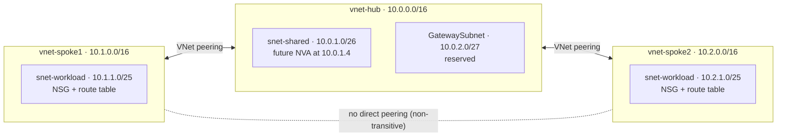
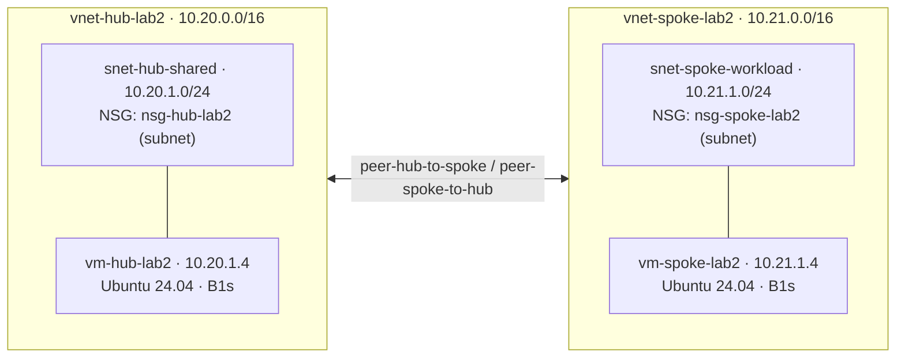

# Azure Hub-and-Spoke Network (Bicep)

A hub-and-spoke virtual network topology on Microsoft Azure, deployed as Infrastructure as Code with Bicep. The repository has two labs:

- **Lab 1: Bicep-first network.** A reusable spoke module deploys multiple isolated spokes from a single array, with least-privilege NSGs and forced routing through the hub.
- **Lab 2: Portal-built connectivity validation.** A small hub-and-spoke environment was built by hand in the Azure portal, then exported, decompiled, and cleaned up into Bicep. Its configuration findings were fixed through code, and connectivity was verified with real traffic tests. See [Lab 2](#lab-2-portal-built-connectivity-validation).

Built as a hands-on project while studying for the **AZ-104: Microsoft Azure Administrator** certification. Everything here is lab work in a personal subscription, not a production environment.

## Problem It Solves

As organizations grow in Azure, putting every workload in one flat network becomes hard to secure and manage. The hub-and-spoke model solves this by:

- Centralizing shared services (VPN gateway, firewall, DNS) in a single **hub** so they're deployed and paid for once
- Isolating workloads in separate **spokes** that connect only to the hub
- Enforcing security and traffic inspection in one place

Lab 1 builds that foundation with least-privilege network security, forced routing through the hub, and a modular design where adding a new spoke takes one line of code.

Lab 2 addresses a different, very common operational problem: **environments built by hand in the portal drift from standards and can't be reproduced.** It shows how to bring an existing environment under code, find what's wrong with it, and fix it safely.

## Architecture (Lab 1)



### Address Plan

| VNet | Address space | Subnet | Prefix | Usable IPs |
|---|---|---|---|---|
| vnet-hub | 10.0.0.0/16 | snet-shared | 10.0.1.0/26 | 59 |
| vnet-hub | 10.0.0.0/16 | GatewaySubnet | 10.0.2.0/27 | 27 |
| vnet-spoke1 | 10.1.0.0/16 | snet-workload | 10.1.1.0/25 | 123 |
| vnet-spoke2 | 10.2.0.0/16 | snet-workload | 10.2.1.0/25 | 123 |
| vnet-hub-lab2 *(Lab 2)* | 10.20.0.0/16 | snet-hub-shared | 10.20.1.0/24 | 251 |
| vnet-spoke-lab2 *(Lab 2)* | 10.21.0.0/16 | snet-spoke-workload | 10.21.1.0/24 | 251 |

Usable IPs account for the 5 addresses Azure reserves in every subnet. No address spaces overlap, which VNet peering requires. Lab 2 uses 10.20.0.0/16 and up so it never collides with Lab 1's spokes.

## Repository Structure

```
├── main.bicep                    # Lab 1: hub VNet, spoke definitions, hub → spoke peerings
├── modules/
│   ├── spoke.bicep               # Lab 1: reusable spoke (VNet, NSG, route table, spoke → hub peering)
│   └── vm.bicep                  # Lab 1 VM layer: reusable Linux VM + NIC
├── vms.bicep                     # Lab 1 VM layer: three B1s VMs (authored and what-if reviewed; not yet deployed)
├── lab2/
│   ├── main.bicep                # Lab 2: portal-built environment codified as Bicep (findings fixed)
│   ├── Test-Lab2Connectivity.ps1 # Lab 2: connectivity retest; always deallocates the VMs
│   └── export/                   # Raw portal export + decompiled output (gitignored; reference only)
└── docs/evidence/                # Sanitized command output for every milestone (m1-*, m2-*, lab2-*)
```

Compiled ARM JSON (`*.json`) and raw portal exports are gitignored. Subscription and tenant IDs in evidence files are replaced with `<guid>`.

## Resources Deployed (Lab 1)

| Resource | Names | Purpose |
|---|---|---|
| Virtual networks | `vnet-hub`, `vnet-spoke1`, `vnet-spoke2` | Hub for shared services; isolated workload spokes |
| VNet peerings (x4) | `peer-hub-to-spokeN`, `peer-spokeN-to-hub` | Bidirectional hub ↔ spoke connectivity |
| Network security groups | `nsg-spoke1-workload`, `nsg-spoke2-workload` | Least-privilege inbound rules per workload subnet |
| Route tables | `rt-spoke1-workload`, `rt-spoke2-workload` | Force spoke egress through the hub |

Every taggable resource carries the standard tags `project`, `environment`, `owner`, and `costCenter`.

## How the Modular Design Works

All spokes are defined in one array in `main.bicep`:

```bicep
var spokes = [
  { name: 'spoke1', addressSpace: '10.1.0.0/16', workloadSubnetPrefix: '10.1.1.0/25' }
  { name: 'spoke2', addressSpace: '10.2.0.0/16', workloadSubnetPrefix: '10.2.1.0/25' }
]
```

A `for` loop calls `modules/spoke.bicep` once per spoke. The module returns each spoke's VNet ID as an **output**, which `main.bicep` uses to create the hub-side peering. Both loops use `@batchSize(1)` because Azure can't modify multiple peerings on the same hub VNet at the same time.

**To add a third spoke:** add one object to the `spokes` array and redeploy.

## Security Design

Each workload subnet NSG allows only what's needed and explicitly overrides Azure's default `AllowVnetInBound` rule. That default rule would otherwise allow **all** traffic from peered VNets.

| Priority | Rule | Source | Port | Action |
|---|---|---|---|---|
| 100 | Allow-HTTPS-From-Hub | Hub address space | 443 | Allow |
| 110 | Allow-Mgmt-From-Shared | Hub shared subnet | 22, 3389 | Allow |
| 120 | Allow-Intra-Subnet | Workload subnet | Any | Allow |
| 4000 | Deny-VNet-Inbound | VirtualNetwork | Any | Deny |

`Allow-Intra-Subnet` was added in Milestone 1. Without it, the priority-4000 deny would also block traffic between VMs in the same workload subnet, because `VirtualNetwork` includes the subnet itself.

## Routing Design

Each spoke has a user-defined route sending all egress (`0.0.0.0/0`) to `10.0.1.4` in the hub, where a firewall or network virtual appliance (NVA) would inspect traffic. Peering is **not transitive**, so this pattern is also how spoke1 and spoke2 would reach each other: through the hub NVA rather than a direct peering.

> **Note:** No NVA is deployed yet, to keep costs at $0. The routes show the design intent. `vms.bicep` defines a `vm-nva` at 10.0.1.4 (IP forwarding off by default) for a future routing scenario.

## Cost Controls

Guardrails were put in place **before** deploying anything:

- **Budget:** $10/month with alerts at 50% and 80% actual spend and 100% forecasted spend
- **Azure Policy:** The built-in *Not allowed resource types* policy, assigned at subscription scope with a Deny effect, blocks expensive resources such as VPN gateways, Azure Firewall, Bastion, NAT gateways, Application Gateway, ExpressRoute, and DDoS Protection plans. It was tested by attempting to create a NAT gateway, which was correctly rejected with `RequestDisallowedByPolicy`.

**Lab 1 running cost: $0.** VNets, subnets, NSGs, route tables, and peering with no traffic are free.

**Lab 2 running cost:** the VMs are kept **deallocated**, so there's no compute charge. The two StandardSSD OS disks still bill while deallocated, at **about $5/month combined (estimate)**. See [Lab 2 cost and preservation](#cost-and-preservation-policy).

## Deploy It Yourself (Lab 1)

**Prerequisites:** Azure subscription, [Azure CLI](https://learn.microsoft.com/cli/azure/install-azure-cli), and Bicep (`az bicep install`).

```bash
az login
az group create --name rg-hubspoke-lab --location eastus
az deployment group what-if --resource-group rg-hubspoke-lab --template-file main.bicep
az deployment group create --resource-group rg-hubspoke-lab --template-file main.bicep
```

### Verify

```bash
# Hub should show two Connected peerings; each spoke shows one (to the hub only)
az network vnet peering list -g rg-hubspoke-lab --vnet-name vnet-hub -o table
az network vnet peering list -g rg-hubspoke-lab --vnet-name vnet-spoke1 -o table
az network vnet peering list -g rg-hubspoke-lab --vnet-name vnet-spoke2 -o table

# Module deployments appear as nested deployments
az deployment group list -g rg-hubspoke-lab -o table
```

Milestone 1 evidence: `docs/evidence/m1-whatif.txt` and `m1-verify.txt` (4 peerings Connected / FullyInSync, NSG rule order 100/110/120/4000). The VM layer's what-if is in `m2-whatif.txt`.

### Clean Up

```bash
az group delete --name rg-hubspoke-lab --yes --no-wait
```

---

## Lab 2: Portal-Built Connectivity Validation

### Why This Lab Exists

Most real Azure environments weren't built from code. Someone clicked through the portal, it worked, and now nobody can say exactly how it's configured or rebuild it. This lab practices the "brownfield to Infrastructure as Code" workflow:

1. Build a small hub-and-spoke environment **by hand in the portal** and confirm it works.
2. **Export** it, **decompile** it to Bicep, and clean the result up until it describes the real environment exactly (verified with what-if).
3. **Find** what's wrong with the portal build, and **fix** each issue through code, one change at a time.
4. **Prove** the fixes with real traffic tests, not just configuration checks.

### Architecture



| Design choice | Reason |
|---|---|
| **No public IPs, no Bastion** | Lower cost and attack surface. Bastion is also blocked by this subscription's cost policy. Tests run through **Azure Run Command**, which works through the VM agent rather than the internet |
| **`defaultOutboundAccess: false`** on both subnets | Private subnets: VMs have no implicit outbound internet access |
| **Standard_B1s, SSH key only** | Lowest-cost size available on this subscription (Basv2 quota is 0). Password authentication is disabled. Private keys stay on the local machine and are never in this repository |
| **VMs stay deallocated between sessions** | Removes compute cost while keeping the lab for reuse |

All Lab 2 resources live in `rg-hubspoke-vms` and carry the tag `lab=lab2`.

### Step A: From Portal to Code

| Step | Result | Evidence |
|---|---|---|
| Inventory the portal build | 12 resources: 2 VNets, 2 NSGs, 2 NICs, 2 VMs, 2 OS disks, 2 SSH public key resources. No public IPs | `lab2-inventory.txt` |
| Export the resource group and run `az bicep decompile` | **18 errors** (10× BCP062, 6× BCP080, 2× BCP079) and 2 linter warnings | `lab2-01-decompile.txt` |
| Clean up by hand into `lab2/main.bicep` | Builds cleanly | `lab2/main.bicep` |
| What-if against the live environment | **0 creates, 0 deletes.** VMs and NSGs unchanged. All "modify" lines are service defaults or read-only fields (noise) | `lab2-02-whatif-asis.txt` |

**Why decompile failed:** the exported template declared subnets and peerings **twice**: inline inside each VNet and again as separate child resources. The two copies referenced each other (BCP080 cycles, BCP079 self-references), and resources pointing at the broken declarations then failed too (BCP062). The fix was to keep subnets inline, keep peerings as separate child resources, and build the NIC subnet IDs from the VNet ID.

`lab2-inventory.txt` also preserves a real tooling failure from that first attempt. JMESPath filters such as `[?contains(name,'lab2')]` broke when passed through `az.cmd` on Windows (`] was unexpected at this time`). The working approach, used in every later command, is to return JSON and filter in PowerShell with `ConvertFrom-Json | Where-Object`.

### Findings and Root-Cause Analysis

| # | Finding | Impact | Root cause | Fix | Verified by |
|---|---|---|---|---|---|
| 1 | The **same NSG was attached to both the subnet and the NIC** | No added security. Every rule is evaluated twice, and effective-rule and IP flow verify output shows two layers for one policy, which confuses troubleshooting | Likely cause (not confirmed): in the VM wizard's Networking tab, the NIC network security group option was pointed at the same NSG that was already attached to the subnet | B.1: removed the NIC association in Bicep; the subnet NSG remains | `lab2-03` to `lab2-06`; effective NSGs in `lab2-16` |
| 2 | **Peering names were swapped.** The hub VNet held `peer-spoke-to-hub` | Names that describe the wrong direction send troubleshooters to the wrong side | Likely cause: manual naming during portal creation. The Add peering dialog asks for both link names (this VNet's and the remote VNet's) on one screen, which makes them easy to swap | B.3: deleted both peerings with the CLI, then recreated them from Bicep with correct names | `lab2-10` to `lab2-15`; routes in `lab2-16` |
| 3 | **No tags** on any resource | Lab 2 cost couldn't be separated from other resources in Cost Management | Tags were never entered in the portal | B.2: standard tag set plus `lab=lab2` via Bicep; disks and SSH keys tagged with a CLI merge | `lab2-07` to `lab2-09` (12 of 12 tagged) |
| 4 | **NSGs contain only the default rules** *(open)* | `AllowVnetInBound` allows **all** traffic from the peered VNet. An initial manual TCP 8080 test from the portal build succeeded for this reason (that test wasn't captured as evidence). Lab 1's NSG design would have denied it | Portal-created NSGs start with defaults only | **Not yet fixed.** Planned: apply a least-privilege rule set like Lab 1's | IP flow verify in `lab2-16` names `AllowVnetInBound` as the allowing rule |

**Prevention:** build from code first. Where portal builds happen, export and what-if them against a standard. Enforce tags with Azure Policy (for example *Require a tag on resources*), because tags don't inherit from a VM to its disks.

### Step B: Fixing Through Code

Each fix followed the same loop: **capture "before" evidence → edit Bicep → what-if → compare it with the previous what-if → deploy → verify.** Comparing what-ifs line by line is what separates real changes from noise. In B.1, the only new lines were the two `- networkSecurityGroup` removals.

| Milestone | Change | Deploy time | Result |
|---|---|---|---|
| B.1 | Remove the NIC-level NSG association | 24 s | Both NICs `[]`; subnet NSGs still attached; peerings unaffected |
| B.2 | Add tags (8 resources in Bicep, 4 by CLI merge) | 4 s | 12 of 12 tagged, 0 missing |
| B.3 | Fix the peering names | 3 s | Correct names, Connected / FullyInSync; drift check shows 0 creates and 0 deletes |
| B.4 | Connectivity retest with real traffic | 5.2 min VM runtime | All tests passed (below) |

The VMs stayed **deallocated** through B.1–B.3. Deploying unchanged VM definitions doesn't start a deallocated VM.

### Controlled Failure: What-If Isn't Validation

A resource can't be renamed in Azure, so "rename a peering" means delete and recreate. Bicep in Incremental mode **never deletes** resources, so changing the names in code tries to **add** two new peerings next to the old ones.

| Test | Result | Evidence |
|---|---|---|
| What-if with new names, old peerings still present | **2 creates, 0 deletes, no warning.** It also showed a misleading `~ name: "peer-spoke-to-hub" => "peer-hub-to-spoke"` line that looks like a rename but isn't a deployment action | `lab2-11` |
| Deploy anyway (deliberately) | **Failed:** `AnotherPeeringAlreadyReferencesRemoteVnet` for both sides. A VNet can't have two peerings to the same remote VNet | `lab2-11a` |
| State after the failure | Old peerings still **Connected**; no partial or failed peering left behind | `lab2-11b` |
| Delete the hub-side peering first | The spoke side immediately showed **`Disconnected`**: one half of a pair, no traffic | `lab2-12` |
| Delete the spoke side, what-if, deploy | Both peerings recreated with correct names; drift check clean | `lab2-13` to `lab2-15` |

**Lesson:** what-if predicts property changes. It doesn't check service rules such as "one peering per remote VNet." A clean what-if is necessary but not sufficient. And when a change needs a delete, the delete should be an explicit, reviewed step rather than something the deployment does by surprise.

### Connectivity Verification (B.4)

`lab2/Test-Lab2Connectivity.ps1` starts both VMs, runs the tests, and **deallocates both VMs in a `finally` block**, so compute can't be left running even if a test fails or the script is interrupted.

| Test | Result |
|---|---|
| Effective NSGs | One NSG per NIC, associated through the **subnet** (confirms fix 1) |
| Effective routes | Hub: `10.21.0.0/16 → VNetPeering`. Spoke: `10.20.0.0/16 → VNetPeering`. Both Active (confirms fix 2) |
| Hub → spoke | 4/4 ping replies (about 2 ms), TCP 22 succeeded |
| Spoke → hub | 4/4 ping replies, TCP 22 succeeded |
| IP flow verify (hub → spoke TCP 22) | `Allow` by `defaultSecurityRules/AllowVnetInBound` |
| Cleanup | Both VMs deallocated; 5.2 minutes from start to deallocation |

Evidence: `lab2-16-connectivity-retest.txt`

**Two things the route table shows:**

- **Longest prefix match.** The platform also installs `10.0.0.0/8 → None` (drop). Traffic to 10.21.1.4 matches both that route and `10.21.0.0/16 → VNetPeering`. The more specific /16 wins. Without the peering, the /8 drop route would apply and packets would be silently discarded.
- **A route isn't a path.** `0.0.0.0/0 → Internet` is listed, but with `defaultOutboundAccess: false` and no public IP or NAT gateway, the VMs still have no outbound internet access.

### Re-Running Lab 2

```powershell
# Read the existing SSH public keys from Azure (no keys are pasted or stored in the repo)
$hubKey   = az sshkey show -g rg-hubspoke-vms -n key-vm-hub-lab2   --query publicKey -o tsv
$spokeKey = az sshkey show -g rg-hubspoke-vms -n key-vm-spoke-lab2 --query publicKey -o tsv

# Drift check: expect 0 to create and 0 to delete (remaining "modify" lines are known noise)
az deployment group what-if -g rg-hubspoke-vms --template-file lab2\main.bicep `
  --parameters hubSshPublicKey="$hubKey" spokeSshPublicKey="$spokeKey"

# Connectivity retest (billable for a few minutes; always deallocates at the end)
.\lab2\Test-Lab2Connectivity.ps1
```

The template targets the existing environment. The OS disk names and SSH keys must match what's deployed, so it isn't meant for a fresh deployment as written.

### Evidence Index

| File | Contents |
|---|---|
| `lab2-inventory.txt` | Initial inventory of the portal build, including the first failed JMESPath attempt |
| `lab2-01-decompile.txt` | Decompile output: 18 errors, 2 warnings |
| `lab2-02-whatif-asis.txt` | Baseline what-if: the code matches the live state |
| `lab2-03` to `lab2-06` | B.1: NIC NSG before, what-if, deploy, verify |
| `lab2-07` to `lab2-09` | B.2: tags what-if, deploy, verify (12 of 12) |
| `lab2-10`, `lab2-11` | B.3: peerings before; what-if with old peerings present |
| `lab2-11a`, `lab2-11b` | Controlled failure and state afterward |
| `lab2-12` to `lab2-15` | Deletion (including the `Disconnected` state), what-if, deploy, verify and drift check |
| `lab2-16-connectivity-retest.txt` | Effective NSGs and routes, ping and TCP tests, IP flow verify, deallocation |

### Cost and Preservation Policy

| Item | Policy |
|---|---|
| VMs | Kept **deallocated**. Started only for tests, through the retest script that always deallocates |
| OS disks | Bill while deallocated, about **$5/month combined (estimate)**. Kept so the lab can be reused |
| Retest cost | About 5 minutes of two B1s VMs (under $0.01) |
| Not used | Public IPs, Bastion, NAT gateway, paid monitoring, Azure Backup, Site Recovery |

**Full teardown (only when Lab 2 is no longer needed):**

```bash
az group delete --name rg-hubspoke-vms --yes
```

> ⚠️ This deletes **everything** in `rg-hubspoke-vms`, including the SSH public key resources. `vms.bicep` also targets this resource group, and its header comment says to delete the group to tear down. Run `az resource list -g rg-hubspoke-vms -o table` and review what's there before deleting.

### Known Limitations

- **Finding 4 is open:** the Lab 2 NSGs still use only default rules.
- **Disk and SSH key tags are outside Bicep.** What-if won't detect them being removed. Azure Policy is the intended control.
- **`lab2/main.bicep` describes the existing environment.** It pins OS disk names and uses existing keys, so it isn't a template for a fresh deployment.
- **The rename needed an imperative step.** Incremental mode can't delete. Complete mode or deployment stacks could, but they would need careful scoping in a resource group shared with other work.
- **Unexplained output:** the effective-NSG output contains a second, empty entry per NIC. The result isn't affected (one NSG is in effect), but its cause wasn't confirmed.
- **No flow logs or monitoring** were enabled (cost). They're planned in the monitoring project.

---

## AZ-104 Exam Objectives Covered

| Domain | Objective |
|---|---|
| Implement and manage virtual networking | Create and configure virtual networks and subnets |
| Implement and manage virtual networking | Create and configure virtual network peering |
| Implement and manage virtual networking | Configure user-defined network routes; interpret effective routes |
| Implement and manage virtual networking | Create and configure network security groups; evaluate effective security rules |
| Monitor and maintain Azure resources | Use Network Watcher (IP flow verify) to troubleshoot connectivity |
| Deploy and manage Azure compute resources | Interpret, modify, and deploy Bicep files; export a deployment as a template |
| Deploy and manage Azure compute resources | Manage VM sizes and power states (deallocated vs. stopped) |
| Manage Azure identities and governance | Implement and manage Azure Policy; apply and manage tags |
| Manage Azure identities and governance | Manage costs by using alerts and budgets |

## What I Learned

- **I planned the address space before writing any code.** I learned that peered VNets can't overlap, so I mapped out non-overlapping ranges for the hub and spokes first and left room for more. I also learned that Azure reserves 5 addresses in every subnet, which changes how many hosts a subnet can really hold.
- **I found out that peering is only half done until both sides exist.** Each VNet needs its own peering pointing at the other; otherwise the state stays *Initiated* and no traffic flows. I also learned peering isn't transitive: my two spokes can't reach each other through the hub unless I peer them directly or route traffic through a firewall in the hub.
- **I learned that Azure's default NSG rules trust peered networks.** The built-in `AllowVnetInBound` rule covers anything in the `VirtualNetwork` service tag, which includes peered VNets. To actually limit access, I had to add my own deny rule and only allow the specific ports and sources the workload needs.
- **I set up cost guardrails before deploying anything.** My subscription is pay-as-you-go with no spending limit, and I learned that a budget only sends alerts; it doesn't stop anything. So I assigned an Azure Policy that blocks expensive resource types and tested it by trying to create a NAT gateway, which Azure correctly rejected.
- **I learned to preview before I deploy.** Running `what-if` showed exactly what would change before each deployment, and seeing existing resources come back as *NoChange* helped me understand how incremental deployment mode leaves everything outside the template alone.
- **I refactored repeated code into a reusable module.** Moving the spoke into its own Bicep module with parameters and outputs meant a second spoke took one line instead of another 100. I also learned that Azure can't update two peerings on the same VNet at once, which is why the loops use `@batchSize(1)`, and that incremental mode doesn't delete renamed resources, so I rebuilt the environment cleanly from code.
- **I learned that exported templates are a starting point, not working code.** Decompiling my portal build produced 18 errors, mostly because subnets and peerings were declared twice. I didn't trust my cleaned-up version until what-if showed zero creates and zero deletes against the live environment.
- **I learned to read what-if critically.** Most "modify" lines were noise from service defaults and read-only fields. I learned to compare each what-if with the previous one so the real change stood out. I also confirmed that what-if can look clean while the deployment still fails: my peering rename showed two clean creates, then failed with `AnotherPeeringAlreadyReferencesRemoteVnet`.
- **I learned to prove fixes with traffic, not just configuration.** Effective security rules, effective routes, Run Command tests, and IP flow verify showed what Azure actually enforces. The route table also showed longest prefix match in action: my /16 peering route won over the platform's 10.0.0.0/8 drop route.
- **I made cleanup automatic instead of something to remember.** My test script deallocates the VMs in a `finally` block, so a failed test or an interrupted run can't leave compute running.

## Future Improvements

- Apply least-privilege NSG rules to Lab 2 (finding 4), then re-run the retest to show the expected allows and denies
- Enforce required tags with Azure Policy instead of tagging disks by hand
- Add a GitHub Actions workflow that runs `what-if` on pull requests
- Move the address plan into a `.bicepparam` file for per-environment deployments
- Deploy the `vms.bicep` VM layer to demonstrate spoke-to-spoke routing through the hub NVA and IP forwarding
- Separate the Lab 2 and `vms.bicep` resource groups so each lab can be torn down independently (also a chance to practice moving resources between resource groups)
